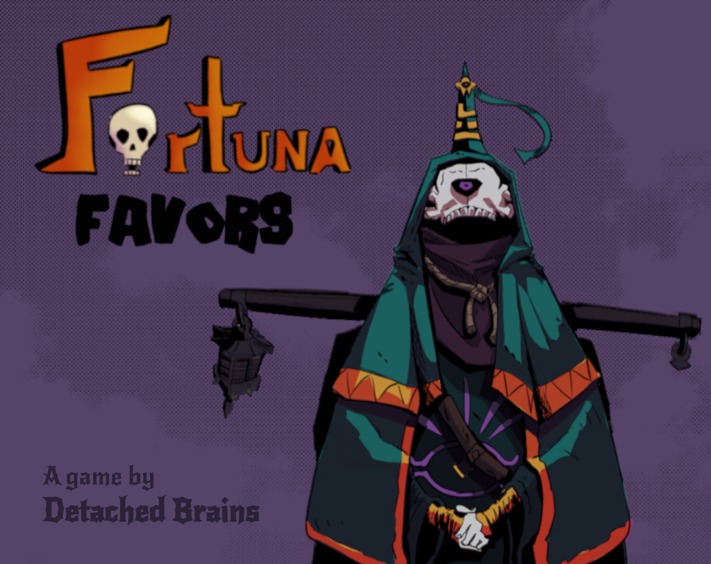

# ꧁𓊈𒆜 ¡ℌ𝔢𝔩𝔩𝔬 𝔣𝔯𝔬𝔪 𝔇𝔢𝔱𝔞𝔠𝔥𝔢𝔡 𝔅𝔯𝔞𝔦𝔫𝔰! 🧠 𒆜𓊉꧂
Play or Fortuna Favor's protoype on Itch.io!

  
   
  

## ‿̩͙⊱༒︎༻ Our Team ༺༒︎⊰‿̩͙</h2>
We are a student group just starting in videogame development! Every comment and feedback encourages us a little bit more, so please tell us what you think about our creations :D

### ✃ ˎˊ˗﹒Developers

•〢ᯓ [@WahWau](https://github.com/WahWau), [@CikiUmi](https://github.com/CikiUmi), [@SrLucas-tecx](https://github.com/SrLucas-tecx)

### ✃ ˎˊ˗﹒Illustrators
•〢ᯓ [@soydarroz](https://github.com/soydarroz), [@ObakeIST](https://github.com/ObakeIST)

---

<small>asdasd</small>

<!--

**Here are some ideas to get you started:**

🙋‍♀️ A short introduction - what is your organization all about?
🌈 Contribution guidelines - how can the community get involved?
👩‍💻 Useful resources - where can the community find your docs? Is there anything else the community should know?
🍿 Fun facts - what does your team eat for breakfast?
🧙 Remember, you can do mighty things with the power of [Markdown](https://docs.github.com/github/writing-on-github/getting-started-with-writing-and-formatting-on-github/basic-writing-and-formatting-syntax)
-->
